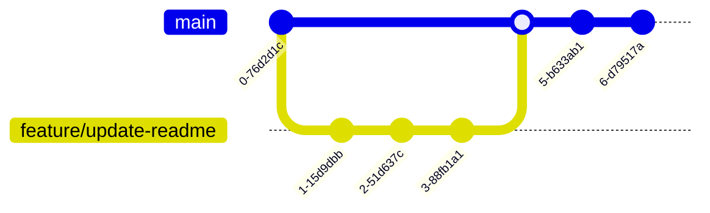

# terraform-aws

AWS のリソースを Terraform で構成する。

## GitHub Actions Status badges

| Name | Environment | Result |
| :--- | :--- | :--- |
| Linterなどによる検証 | Lefthook |  |
| AWS 検証環境 | Sandbox |  |
| AWS ポートフォリオ | Management |  |
| AWS 全体管理 | Management |  |

## ブランチ設計



1. GitHub Flow で運用します。
2. `main` がデフォルトブランチです。
3. `main` ブランチにマージされると GitHub Actions で `terraform apply` でインフラが更新されます。
   - **マージのタイミングがデプロイに相当します。**

## Terraform の構成

- `terraform/envs/`: 環境ごとのルート構成。
- `terraform/modules/`: 共通部品と用途別のモジュール。
  ドメイン、証明書、デプロイ用ロールなどもこのディレクトリで管理します。

### 依存関係の可視化

GitHub Actions の `Terraform Graph` を手動実行し、対象環境を選択します。
各ルートの `terraform-graph-<環境名>-<ルート名>` artifact をダウンロードすると、
`dependency-graph.svg` をブラウザで表示できます。DOT ファイルも同梱し、保存期間は 7 日です。
ワークフローは `terraform/envs/<環境名>/*/terraform.tf` から対象を選びます。

Terraform 標準の簡略化されたグラフを Graphviz で SVG に変換します。
構成内のリソース・データソースの依存関係を示し、実際の AWS 構成や apply の差分は示しません。
Terraform 構成を一時コピーし、backend を空の local backend に置き換えるため、
AWS 認証や既存 state は不要です。元の構成・state・lockfile は変更しません。
lockfile は読み取り専用で扱います。デプロイ用ワークフローとは独立しています。

ローカル実行には、通常のセットアップに加えて Graphviz の `dot` コマンドが必要です。
macOS は `brew install graphviz`、Ubuntu は `sudo apt-get install graphviz`、
Windows は [Graphviz 公式配布](https://graphviz.org/download/)からインストールして PATH に追加します。
生成スクリプトは Python 3 で実行します。
Graphviz は任意の可視化用ツールのため、通常のセットアップには追加していません。
CI は Ubuntu のパッケージを使用するため、Graphviz の更新で SVG の配置が変わる場合があります。

```bash
PATH="$(mise where terraform):$PATH" python3 scripts/terraform-graph.py terraform/envs/portfolio/base_apne1 /tmp/terraform-graph
```

## module 化しないリソース

| リソース | 理由 |
| :--- | :--- |
| [aws_iam_role_policy_attachment](https://registry.terraform.io/providers/hashicorp/aws/latest/docs/resources/iam_role_policy_attachment) | パラメータが少なすぎて module 化するメリットがない |
| [aws_route53_record](https://registry.terraform.io/providers/hashicorp/aws/latest/docs/resources/route53_record) | リソースの種類が多く汎用的な module にするコストに見合うメリットがない |

## セキュリティポリシー

### AWS の認証方法

- GitHub Actions から AWS のリソースをデプロイするときの認証方式は OIDC です。
- Credential は管理面の手間がかかるため採用していません。

## EditorConfig 設定

包括的なコーディング規約として EditorConfig を使用しているため、[公式ページの Download a Plugin](https://editorconfig.org/#download) のエディタ・IDE を使用している場合は、プラグインを追加してください。

## AI 開発ツールの共通ルール

Codex、Claude Code、GitHub Copilot、Cursor のルールとスキルは
[共通ルール](docs/rules/overview.md)、[スキルの生成元](.rulesync/skills/)、[rulesync 設定](rulesync.jsonc) で管理します。
Node.js 24 と npm を使用します。macOS・Linux・Windows で同じ npm コマンドを実行できます。

```bash
npm ci
npm run rules:generate
npm run rules:check
```

| ツール | 生成ファイル |
| :--- | :--- |
| Codex | `AGENTS.md` |
| Claude Code | `AGENTS.md`（Codex と共用） |
| GitHub Copilot | `.github/copilot-instructions.md` |
| Cursor | `.cursor/rules/overview.mdc` |

Claude Code v2.1.277 以降は、ルートの `CLAUDE.md` を置かずに `AGENTS.md` を使用します。
共通ルールの生成対象は Codex、GitHub Copilot、Cursor とし、Claude Code のスキル生成は維持します。
ルールを変更するときは `docs/rules/overview.md` を編集し、再生成してください。
スキルの詳細な手順は `docs/rules/<スキル名>.md` に置きます。
`.rulesync/skills/<スキル名>/SKILL.md` には適用条件と原本への参照を記述し、同じコマンドで再生成します。
各ツールのスキルは実行前に原本を読み、手順を複製しません。
スキル専用の原本は YAML メタデータに `targets: []` を指定し、ルールの生成対象から除外します。
`update-gitignore` は Toptal の最新テンプレートから `.gitignore` の生成ブロックを更新するスキルです。
手順の原本は [.gitignore の更新手順](docs/rules/update-gitignore.md) です。
生成先は Codex の `.agents/skills/`、Claude Code の `.claude/skills/`、
GitHub Copilot の `.github/skills/`、Cursor の `.cursor/skills/` です。
生成元・設定・生成ファイルを一緒にコミットします。生成ファイルは直接編集しません。
CI の `rulesync` ジョブで同期漏れを検出します。
個人用の上書き設定 `rulesync.local.jsonc` は Git の管理対象外です。

## セットアップ

### リポジトリのセットアップ

Git と [mise](https://mise.jdx.dev/installing-mise.html) を事前にインストールし、
リポジトリのルートで次のコマンドを実行します。

```bash
mise trust
mise install
mise run setup
```

Terraform、Node.js、検証ツールのバージョンは `mise.toml` で管理します。
`mise run setup` は lockfile に従って npm 依存をインストールし、Lefthook の Git フックを設定します。
npm のライフサイクルスクリプトは実行しません。既存の pre-commit フックは置き換えます。
Homebrew の導入やシェル設定は個人の環境で管理してください。anyenv と tfenv は不要です。

```bash
# Lefthook で全ファイルを検証
mise run lint

# 回帰テストを実行（Python 3 と Git が必要）
mise run test
```

CI の `Repository Setup` は macOS・Linux で同じセットアップタスクを実行し、
Terraform、npm の検証ツール、Git フックが利用できることを確認します。

ツールのバージョンを変更するときは `mise.toml` と関連するバージョンファイルを更新し、
`mise install` と検証を実行してください。Node.js は `.node-version`、
Terraform は `.terraform-version` と同じバージョンにします。

### 任意の追加ツール

AWS 接続やコンテナを使用する場合に、必要なツールを個人の環境へ導入します。
リポジトリのセットアップや lint・回帰テストでは、これらのツールをインストールしません。

| ツール | 用途 | 導入方法 |
| :--- | :--- | :--- |
| aws-vault | 後述のローカル AWS 認証 | [公式のインストール手順](https://github.com/ByteNess/aws-vault#installing) |
| Session Manager plugin | AWS Systems Manager のセッション接続 | [AWS 公式手順](https://docs.aws.amazon.com/ja_jp/systems-manager/latest/userguide/session-manager-working-with-install-plugin.html) |
| Rancher Desktop | ローカルのコンテナ環境 | [公式の OS 別手順](https://docs.rancherdesktop.io/getting-started/installation/) |

macOS で Homebrew を利用する場合も、上記の各公式手順に従って導入してください。
Linux・Windows では、それぞれの OS と CPU に対応する手順を選択してください。

### GitHub Actions の SHA 固定

`pinact` は `mise.toml` でバージョンを固定して管理します。
リポジトリのルートでセットアップし、ローカルで Actions を SHA に固定できます。

```bash
mise trust
mise install
mise exec -- pinact --version

# ワークフローと composite action の参照を SHA に固定
mise exec -- pinact run

# ファイルを書き換えずに固定状態を確認
mise exec -- pinact run --check
```

ツールのインストールだけを実行する場合は `mise install` を使用します。
`pinact run` の変更後は差分を確認してコミットしてください。

### Lefthook

```bash
# 検証ツールと Git フックをセットアップ
mise install
mise run setup
```

既存の pre-commit フックは `mise exec -- lefthook install` で置き換えます。
`mise run lint` は全ファイル、コミット時はステージ済みファイルを検証します。
安全チェックの Python 依存は uv が初回実行時に取得します。
pre-commit の CLI は不要です。安全チェックは pre-commit-hooks を直接呼び出します。
検証はファイルを自動修正しません。512 KiB のサイズ制限は生成物 `package-lock.json` を除いて適用します。

### ローカルから Terraform CLI を実行する方法

#### AWS Profile の設定

これは下記の `aws-vault exec` コマンドで使用されます。
下記の内容を `~/.aws/config` に設定します。

```bash
[profile terraform-aws-management]
sso_start_url = https://tqer39-management.awsapps.com/start/
sso_region = ap-northeast-1
sso_account_id = 577523824419
sso_role_name = <AWS SSO Role Name>
region = ap-northeast-1
output = json
```

### Terraform のセットアップ

```bash
mise install
mise exec -- terraform -v
```

コマンドのフォーマット

- `AWS CLI (SSO) の profile`: 前項で設定した AWS CLI の profile
- `実行先のパス`: Terraform CLI を実行するパス
- `Terraform コマンド`: `terraform` に続くコマンド

```bash
# Format:
aws-vault exec "${AWS CLI (SSO) の profile}" -- terraform -chdir="${実行先のパス}" "${Terraform コマンド}"
```

#### terraform init（初期化）

```bash
# Example:
aws-vault exec terraform-aws-management -- terraform -chdir=./terraform/envs/dev/base_apne1 init
```

#### terraform validate

```bash
# Example:
aws-vault exec terraform-aws-management -- terraform -chdir=./terraform/envs/dev/base_apne1 validate
```

#### terraform plan

```bash
# Example:
aws-vault exec terraform-aws-management -- terraform -chdir=./terraform/envs/dev/base_apne1 plan
```

#### terraform apply

**※ローカルからのデプロイは原則禁止です。**

```bash
# Example:
aws-vault exec terraform-aws-management -- terraform -chdir=./terraform/envs/dev/base_apne1 apply -auto-approve
```

## 新しい環境の作成方法

手動で s3 バケットを作成。
リソースを作成。

```txt
.github/workflows/terraform-aws-<環境名>.yml
terraform/envs/<環境名>/base/main.tf
terraform/envs/<環境名>/base/provider.tf
terraform/envs/<環境名>/base/terraform.tf
terraform/envs/<環境名>/base/shared-locals.tf
terraform/envs/<環境名>/shared/locals.tf
```

```zsh
# https://xxxxx.awsapps.com/start#/
export AWS_ACCESS_KEY_ID="XXXXXXXXXX"
export AWS_SECRET_ACCESS_KEY="XXXXXXXXXX"
export AWS_SESSION_TOKEN="XXXXXXXXXX"

terraform -chdir=terraform/envs/<環境名>/base init
```

手動で作成した s3 バケットを import。

```zsh
$TF_PATH="terraform/envs/<環境名>/base"
terraform -chdir="$TF_PATH" import module.terraform-backend.module.s3-bucket.aws_s3_bucket.this <バケット名>
terraform -chdir="$TF_PATH" import module.terraform-backend.module.s3-bucket.aws_s3_bucket_acl.this <バケット名>
terraform -chdir="$TF_PATH" import module.terraform-backend.module.s3-bucket.aws_s3_bucket_public_access_block.this <バケット名>
terraform -chdir="$TF_PATH" import module.terraform-backend.module.s3-bucket.aws_s3_bucket_versioning.this <バケット名>
```

OIDC 関連のリソースの新規作成と s3 バケットのパラメータ更新を行います。

```zsh
$TF_PATH="terraform/envs/<環境名>/base"
terraform -chdir="$TF_PATH" fmt
terraform -chdir="$TF_PATH" validate
terraform -chdir="$TF_PATH" plan
terraform -chdir="$TF_PATH" apply -auto-approve
```
