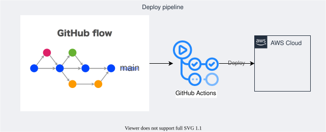

# デプロイフロー

[README](../../README.md) / [Terraform の運用](../terraform-operations.ja.md)

## 変更の流れ

GitHub Flow で作業ブランチから PR を作成し、検証・レビュー後に `main` へマージします。
現行ワークフローでは、マージ時に apply は実行しません。

| イベント | Terraform の処理 |
| :--- | :--- |
| PR | 変更に関係するルートを AWS 認証なしで fmt・init・validate |
| `main` への push | 変更に関係するルートを OIDC 認証で plan |
| 定期実行 | デプロイ対象一覧のルートを plan して差分を確認 |
| `main` での手動実行 | plan。`CHECK_DIFF=_false` かつ差分がある場合に apply |

AWS 認証を使うジョブには、リポジトリ変数 `TERRAFORM_EXECUTION_ENABLED=true` が必要です。
未設定や `false` の場合はスキップします。Markdown だけの変更では、PR・push の Terraform 対象は選択されません。
手動・定期実行は [デプロイ対象一覧](../../.github/workflows/deploy_pipeline/)に記載されたルートを選択します。

## GitHub Actions での実行

1. 対象環境のワークフローを開きます。
   [Management](../../.github/workflows/_terraform-aws-management.yml)、
   [Portfolio](../../.github/workflows/_terraform-aws-portfolio.yml)、
   [Sandbox](../../.github/workflows/_terraform-aws-sandbox.yml) が対象です。
2. `main` を選び、`CHECK_DIFF=_true`（既定値）で手動実行して plan を確認します。
3. plan をレビューした後、反映する場合は `main` と `CHECK_DIFF=_false` を指定して手動実行します。
   この実行でも plan を取り直し、差分があるルートだけ apply します。
4. 実行ログとデプロイ結果を確認します。

GitHub Actions は OIDC を使用します。ローカルからのデプロイは原則禁止です。
権限と認証の詳細は [GitHub Actions のサプライチェーン対策](../github-actions-security.ja.md)を参照してください。
実際のリポジトリ変数、AWS 側の信頼ポリシー、ロールの権限は実行前に確認します。

## ブランチ運用の図

この図はブランチ運用の参考です。apply の実行条件は上記の手順とワークフローを参照してください。

